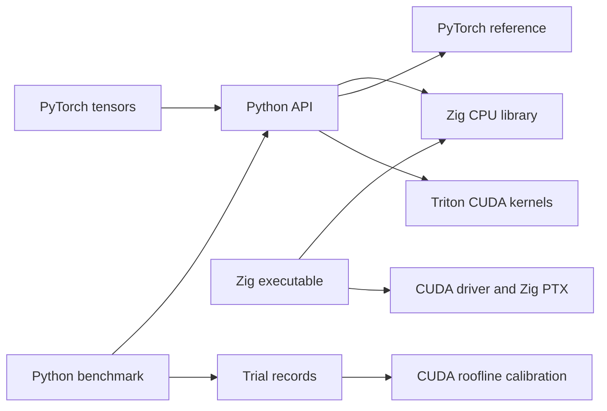

# Triton kernel optimizer

[](https://github.com/asigdel29/triton-kernel-optimizer/actions/workflows/check.yml)
[](LICENSE)

Run causal attention and residual RMSNorm on CPU or NVIDIA GPU. Measure each operation with a standalone Zig executable or through its PyTorch interface.

## Contents

- [Overview](#overview)
- [Architecture](#architecture)
- [Requirements](#requirements)
- [Standalone CPU quickstart](#standalone-cpu-quickstart)
- [Quickstart](#quickstart)
- [Interface](#interface)
- [Measurements](#measurements)
- [Continuous integration and benchmark artifacts](#continuous-integration-and-benchmark-artifacts)
- [Documentation](#documentation)
- [Graphify source map](#graphify-source-map)
- [Contributions](#contributions)
- [License](#license)

## Overview

Attention uses an online softmax to process past tokens without allocating a square score matrix. RMSNorm adds a residual and normalizes the result across channels. Both operations implement the forward pass.

CPU parity and CUDA assembly have passed verification. The [test log](docs/test-log.md) records which checks ran on hardware.

## Architecture



| Component | Responsibility |
| --- | --- |
| [Python package](kernel_optimizer/) | Validate tensors, select a backend, and expose the benchmark and roofline tools. |
| [Native runtime](native/) | Compute CPU and FP32 GPU outputs. Launch kernels and time standalone trials. |
| [Tests](tests/) | Check shape errors, CPU precision, strided tensors, and CUDA parity when available. |
| [Benchmark suite](scripts/benchmark.sh) | Run paired cases and record the environment, trial samples, and revision. |

## Requirements

| Path | Requirements |
| --- | --- |
| Standalone CPU | Zig 0.16.0 for source builds. The executable runs without Python. |
| Python CPU | Python 3.10+ and PyTorch 2.3+. The source package installs its build-time Zig dependency. |
| Standalone CUDA | Linux, an NVIDIA GPU with compute capability 7.5+, and a driver that can load the embedded PTX. |
| Python CUDA | Linux, a compatible driver, CUDA-enabled PyTorch, and the `gpu` extra. Install the `profile` extra for charts. |

## Standalone CPU quickstart

Run these commands from the checkout.

```sh
make native-check
make native-bench ARGS="--tokens 17 --depth 13 --repeats 3"
```

Expect two JSON lines. Each contains three latency samples in nanoseconds. Change the dimensions and repeat count to measure another case.

## Quickstart

Build and install the Python interface in a virtual environment.

```sh
python3 -m venv .venv
. .venv/bin/activate
python -m pip install .
make native
make check
make demo
```

The demo exercises the Python benchmark. The [runbook](docs/runbook.md) covers installation checks, CUDA execution, sample capture, and failure handling.

## Interface

```python
import torch
from kernel_optimizer import causal_attention, residual_rms_norm

q = torch.randn(1, 2, 17, 32)
out = causal_attention(q, q, q, backend="zig")
normalized = residual_rms_norm(out, q, torch.ones(32), backend="zig")
assert normalized.shape == q.shape
```

Choose `torch` for the reference or `triton` for supported CUDA inputs. The Python API defaults to `auto`. See [dispatch and precision](docs/design/dispatch.md) for the selection rules.

## Measurements

Select a new output directory for each run.

```sh
PYTHON=.venv/bin/python bash scripts/benchmark.sh cpu results-cpu
```

The suite records 128- and 513-token cases at depth 64. Compare the same shape, precision, device, and timer boundary. The [measurement design](docs/design/measurement.md) defines the operation and traffic estimates.

## Continuous integration and benchmark artifacts

Hosted CI tests the wheel on Python 3.10 and 3.12. The 3.12 job assembles both GPU entry points and uploads CPU benchmark data. A separate workflow runs on a registered Linux x64 CUDA runner.

| Check | Command or workflow |
| --- | --- |
| Zig tests and format | `make native-check` |
| Tensor parity and invalid inputs | `make check` |
| Standalone executable | `make native-bench` |
| GPU parity and calibrated roofline | [CUDA benchmark](.github/workflows/cuda.yml) |

## Documentation

| Document | Use |
| --- | --- |
| [System design](docs/system-design.md) | Follow a forward call through the UML sequence and component diagrams. |
| [Dispatch and precision](docs/design/dispatch.md) | Choose a backend and prepare compatible tensors. |
| [Measurement design](docs/design/measurement.md) | Compare timer boundaries and interpret a roofline point. |
| [Runbook](docs/runbook.md) | Build the software, verify a device path, and collect artifacts. |
| [Operations reference](docs/operations.md) | Look up individual commands, file fields, and errors. |
| [Test log](docs/test-log.md) | Check the tested revision, inputs, results, and hardware coverage. |

## Graphify source map

Open the [report](graphify-out/GRAPH_REPORT.md), [JSON graph](graphify-out/graph.json), or [interactive map](graphify-out/graph.html). View the HTML locally.
Install the tool with `uv tool install graphifyy==0.9.76`. Stage new Python and Zig source files before rebuilding the map.

```sh
make graph
graphify query "rms_norm"
```

## Contributions

Read the [repository instructions](AGENTS.md). Run the native and Python checks before opening a pull request. Describe the shapes, device, precision, and any skipped hardware tests.

## License

[Apache License 2.0](LICENSE).
