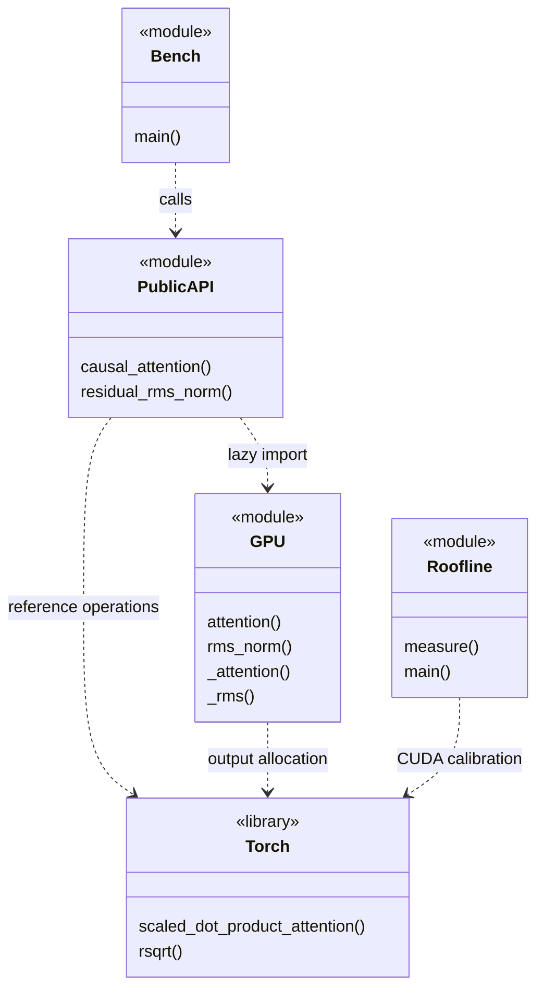
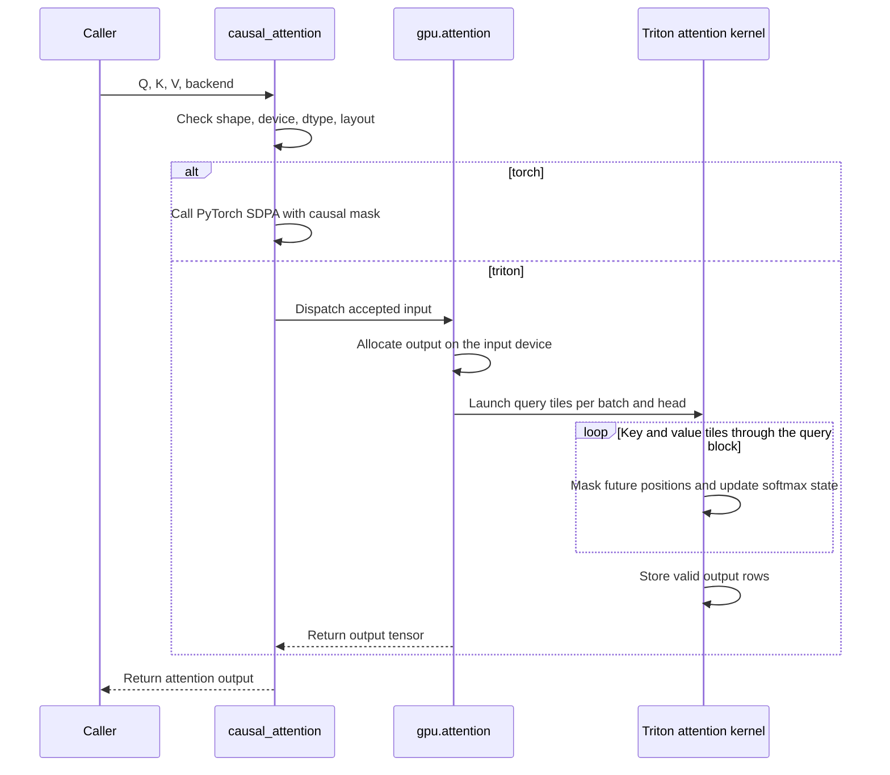

# Kernel system design

This library executes two independent forward operations. The caller owns all input tensors. Each operation returns a new tensor with the activation shape, device, and dtype.

## Component dependencies

The diagram represents Python modules as UML classifiers. Each arrow identifies a call or import dependency.

The public API holds input checks and the PyTorch implementation. The GPU module holds Triton launchers and kernels. The benchmark produces JSONL records. The roofline program reads these records in a separate process.

## Tensor contracts

| Operation | Input contract | Triton constraint |
|---|---|---|
| Causal attention | Q, K, and V share a nonempty `[batch, heads, tokens, depth]` shape. | Depth must be 16, 32, 64, or 128. |
| Residual RMSNorm | X and residual share a nonempty shape. The weight vector length equals the last dimension. | The last dimension has at most 16,384 channels. |

All tensors in one call must share a device and dtype. PyTorch accepts FP32, FP16, and BF16 inputs. Triton requires contiguous CUDA inputs in FP16 or BF16. RMSNorm requires a positive finite epsilon. Its default is `1e-6`.

## Attention execution

A program processes one query block for one batch and head. It keeps a row maximum, denominator, and value accumulator in FP32. When the maximum changes, the program rescales the previous denominator and accumulator. It divides the accumulator by the denominator after the final tile.

This design avoids a full token-by-token score tensor in GPU global storage. The kernel masks future keys and out-of-range positions. Autotuning considers query blocks of 32 and 64 rows with a key block of 32. Token count and head depth form the explicit tuning key.

## Residual RMSNorm execution

Each GPU program owns one flattened row. It loads activations, residuals, and weights into FP32. It adds the residual and computes the reciprocal root mean square across valid channels. The output equals the sum times this scale times the channel weight. The program masks unused lanes in the final power-of-two block.

## Measurement boundary

Kernel timing includes output allocation, Python dispatch, and CUDA synchronization. Each case has five warmup calls. The benchmark records each subsequent call with a host clock. Calibration uses CUDA events around device copies and matrix multiplication.

For a single head and batch, the attention model counts `2 × N × (N + 1) × D` operations. RMSNorm uses `5 × N × D`. The byte model assumes one read per input and one write per output. Actual transfers depend on cache behavior, tile reuse, and the backend.

The roofline combines measured calibration ceilings with modeled kernel work. A point above or below the roof needs inspection of both models and measurements. Compare artifacts on the same GPU and precision. [Operating guide](operations.md)
